# BIOCHAR CONNECT: Master Transformation & Migration Plan

## 1. System Architecture Overview

BIOCHAR CONNECT (AgroMaya) transitions from a simulated demonstration into a production-grade, full-stack application connecting four stakeholders:
1. **Farmers**: Draw field boundaries, monitor real crop phenology via Copernicus Sentinel-2 remote sensing, verify identity via consented biometrics, earn non-inflationary biochar credits for verified crop residues, and spend credits in the agricultural marketplace.
2. **Gram Panchayats (GP)**: Local rural governance units that coordinate collections, perform consented biometric verification or manual override at village collection centers, record certified weighbridge receipts, and maintain local residue inventory.
3. **Biochar Industrial Companies**: Monitor real harvest windows across Karnataka, issue targeted and bulk procurement requests, verify QC batches, settle agricultural credit allocations, and purchase fertilizer inputs from suppliers on behalf of farmers.
4. **Fertilizer & Agricultural Suppliers**: Receive validated purchase orders backed by biochar company fiat settlement (via Razorpay Sandbox / Bank Transfer settlement workflow), confirm stock, dispatch shipments with live tracking numbers, and fulfill orders.

```mermaid
flowchart TD
    subgraph SATELLITE_PIPELINE["1. Real Satellite & Remote Sensing Engine"]
        FARM["Farmer / GP Polygon Draw"] --> STAC["Copernicus / Element-84 STAC Query"]
        STAC --> BANDS["Band Reflectance Retrieval (B04 Red, B08 NIR, B03 Green, B11 SWIR)"]
        BANDS --> INDICES["NDVI, NDWI, EVI & Cloud Masking"]
        INDICES --> PHENO["Crop Phenology & Residue Tonnage Modeling"]
    end

    subgraph BIOMETRIC_ENGINE["2. Consented Biometric Security System"]
        CONSENT["Bilingual Consent (EN/KN)"] --> CAM["Camera Capture & Quality Check"]
        CAM --> EMBED["Face Landmark & Vector Embedding (128-d)"]
        EMBED --> SECURE["Encrypted Biometric Hash & Template Store"]
        SECURE --> MATCH["1:1 Vector Distance Verification at GP"]
    end

    subgraph CREDIT_MARKETPLACE["3. Immutable Credit Ledger & Supplier Settlement"]
        DELIVERY["GP Certified Delivery"] --> WALLET["Atomic Credit Ledger Increment"]
        WALLET --> STORE["Farmer Purchases Inputs with Credits"]
        STORE --> PAYABLE["Company Supplier Payable (INR)"]
        PAYABLE --> GATEWAY["Razorpay Gateway / Settlement Adapter"]
        GATEWAY --> DISPATCH["Supplier Dispatches Inputs & Enters Tracking"]
        DISPATCH --> FULFILL["Farmer Receives Order"]
    end
```

---

## 2. Technical Stack & Implementation Map

| Subsystem | Existing State | Target Production Implementation |
| :--- | :--- | :--- |
| **Satellite Intelligence** | `random.uniform()` pseudo-random generator | Real Copernicus Sentinel-2 STAC querying (Element-84 / CDSE / Microsoft Planetary STAC) + MapMyCrop API adapter + NumPy/SciPy optical index calculator (NDVI, NDWI, EVI) + true cloud masking |
| **GIS & Mapping** | Leaflet with basic SVG polygons | Interactive Leaflet + ESRI World Imagery / CartoDB / OSM + GeoJSON Polygon drawing tool for farmers & GPs + Karnataka Panchayat Collection Center network + road distance & routing engine |
| **Farmer Identity** | Plain database text record | Full registration with GPS auto-detection + Bilingual Biometric Consent (English/Kannada) + Browser WebRTC face capture + quality analysis + 128-d biometric feature vector generation + fallback OTP/manual verification |
| **GP Delivery Verification** | Simulated button click | Multi-step delivery verification workflow: farmer lookup, 1:1 camera biometric matching against enrolled template, weighbridge weight entry, moisture test, delivery photo upload, certified manifest generation |
| **Credit Ledger** | Simple integer update | Strict Double-Entry Ledger (`CreditTransaction` model) with row-level transaction safety, guaranteed prevention of double-spending or duplicate issuance |
| **Input Marketplace** | Farmer clicks buy, credits deducted with no supplier | 3-way connected workflow: Farmer buys with credits -> Biochar Company receives order & creates INR supplier payable -> Company settles supplier via Razorpay Sandbox / Bank Transfer -> Supplier dashboard receives paid PO -> Supplier dispatches with tracking |
| **Supplier Portal** | Did not exist | Full Supplier Dashboard (`/supplier`) for inventory management, purchase order intake, dispatch confirmation, and tracking number assignment |

---

## 3. Database Schema Extensions

To support the real end-to-end workflow without hardcoding or mocks, the Prisma database schema is expanded with:
1. `BiometricEnrollment`: Stores consent timestamp, image quality metrics, encrypted biometric feature vector, and operator reference.
2. `Supplier`: Manages certified fertilizer and agricultural input manufacturers.
3. `SupplierPayable` & `SupplierPayment`: Tracks company financial obligations to suppliers, payment gateway transaction IDs, and confirmation status.
4. `Shipment`: Manages tracking numbers, transport carriers, dispatch timestamps, and delivery milestones.
5. `PanchayatCollectionCenter`: Real geographical coordinates of APMC yards and GP collection points across Karnataka.
